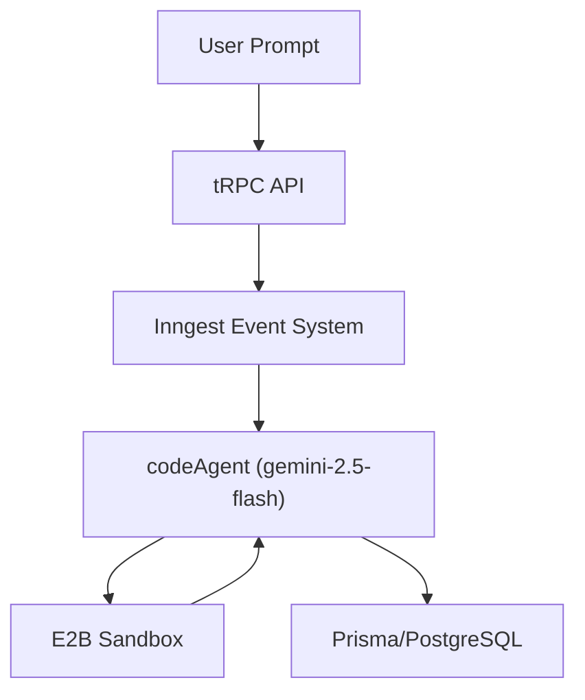

<div align="center" style="text-align: center;">

<h1>NeoCode</h1>

<p>
  NeoCode is a website builder powered by AI agents for building website only using single prompt. NeoCode utilizes several LLM for code generation and task summarization. 
  Currently, NeoCode is capable of building a website from scratch using pre-installed NextJS template in a sandbox environment powered by E2B. 
</p>

<h3>
  <a href="https://neocode-one.vercel.app/">Live Demo</a>
</h3>


</div>

<table>
  <tr>
    <td></td>
    <td></td>
  </tr>
</table>

## Overview

NeoCode is an AI-powered website builder that generates complete Next.js applications from single prompts using a multi-agent architecture. The system orchestrates specialized AI agents to handle code generation, task summarization, and user response creation in isolated sandbox environments. 

## Quick Start

### Prerequisites

Before you begin, ensure you have the following:

- **Development Tools**: git, recent Node.js and NPM
- **API Keys & Services**:
  - E2B API key for sandbox environments
  - Gemini API key for AI model access
  - Neon database URL for PostgreSQL
  - Clerk secrets for authentication and billing

### Installation

1. Clone the repository:
```bash
git clone <repository-url>
cd neocode
```

2. Install dependencies:
```bash
npm install
```

3. Configure environment variables:
```bash
# Copy the example environment file
cp .env.example .env.local

# Edit with your API keys and configuration
```

4. Set up the database:
```bash
npx prisma migrate dev
npx prisma generate
```

5. Start the development server:
```bash
npm run dev
```

## Usage Guide

### Basic Usage

1. **Access the Application**: Navigate to `http://localhost:3000`
2. **Enter Your Prompt**: Describe the website you want to build in natural language
3. **Wait for Generation**: The AI agents will create your application in the sandbox
4. **Preview Results**: View the generated application with the provided preview URL

## Development Guide

### Architecture Overview

NeoCode uses a multi-agent system with the following key components:



### Core Components

**1. Agent System** (`src/inngest/functions.ts`)
- `codeAgentFunction`: Main orchestrator that handles the entire workflow.
- `codeAgent`: Primary AI agent for code generation using Gemini 2.5 Flash.
- `createNetwork`: Manages iterative execution with router logic.

**2. State Management**
The system maintains state through the `AgentState` interface: 
```typescript
interface AgentState {
  summary: string,
  files: { [path: string]: string }
}
```

**3. Tool System**
The agent interacts with the sandbox through three main tools:
- `terminal`: Execute shell commands (npm install, etc.)
- `createOrUpdateFiles`: Write files to the sandbox
- `readFiles`: Read file contents for verification

### Adding New Features

**1. Extending the Agent Tools**
To add new capabilities, modify the tools array in `src/inngest/functions.ts`:

```typescript
tools: [
  // Existing tools...
  createTool({
    name: "your-new-tool",
    description: "Description of what it does",
    parameters: z.object({
      // Define your parameters
    }),
    handler: async ({ parameters, step, network }) => {
      // Implementation
    }
  })
]
```

**2. Modifying the System Prompt**
Update `src/prompt.ts` to:
- Add new coding standards
- Include additional component libraries
- Modify workflow instructions
- Update success criteria

**3. Customizing the Sandbox**
Modify the sandbox configuration in the agent function:
```typescript
const sandbox = await Sandbox.create("neo-test-1");
await sandbox.setTimeout(SANDBOX_TIMEOUT);
```

### Development Workflow

**1. Local Development**
- Use `npm run dev` for the main application
- Test prompts through the web interface
- Monitor agent execution in the console

**2. Debugging Agent Execution**
- Check Inngest dashboard for function execution
- Review sandbox logs for file operations
- Examine database records for generated content

**3. Testing Changes**
- Test with various prompt types
- Verify component imports and usage
- Check responsive design output
- Validate TypeScript compilation

## Deployment

### Environment Setup

1. **Production Database**: Configure Neon PostgreSQL
2. **API Keys**: Set up production API keys for all services
3. **Environment Variables**: Configure all required environment variables

### Deployment Steps

1. **Build the Application**:
```bash
npm run build
```

2. **Deploy to Vercel**:
```bash
vercel --prod
```

3. **Configure Inngest**: Set up production Inngest functions

## Contributing

### Submitting Changes

1. Fork the repository
2. Create a feature branch
3. Implement your changes
4. Test it
5. Submit a pull request with detailed description


